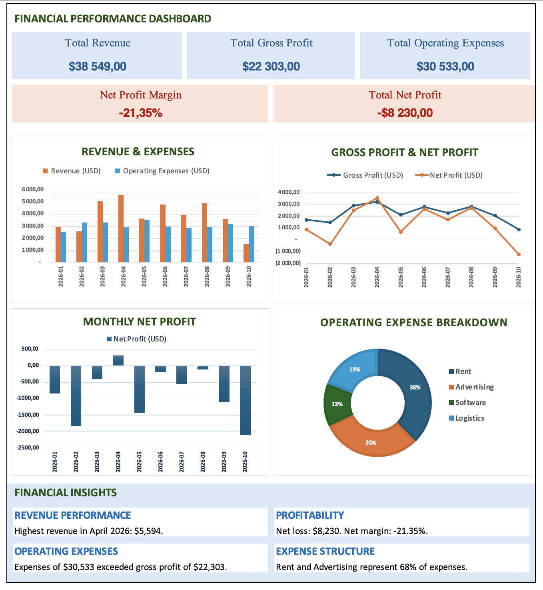
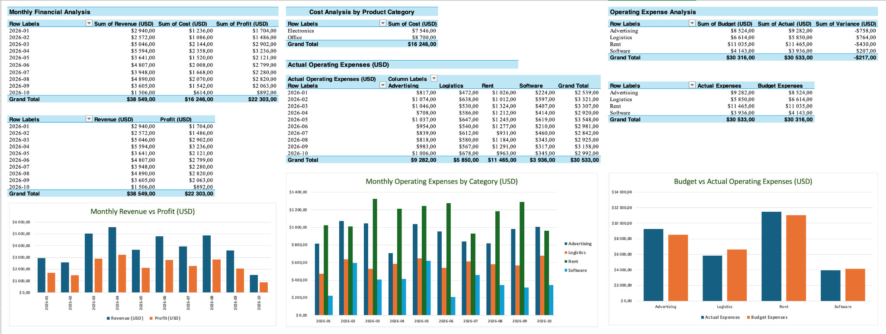

# Financial Performance Analysis & Dashboard

## Project Overview

This project focuses on analysing a company's financial performance using Microsoft Excel. It includes financial calculations, monthly performance analysis, expense monitoring, budget vs. actual comparisons, PivotTables, PivotCharts, and an interactive financial dashboard.

The objective is to transform raw financial data into meaningful insights that support financial planning, performance monitoring, and business decision-making.

## Tools & Skills

- Microsoft Excel
- PivotTables and PivotCharts
- Excel formulas and functions
- SUMIFS, IF, and lookup functions
- Financial reporting and analysis
- Budget vs. Actual analysis
- Data visualization
- KPI monitoring and dashboard development

## Workbook Structure

| Worksheet | Description |
|---|---|
| Sales_Data | Source sales data |
| Expenses | Operating expense data |
| Monthly_Summary | Monthly financial calculations |
| Analysis | Financial analysis, formulas, and insights |
| Dashboard | Financial performance dashboard |
| Pivot Analysis | PivotTables and PivotCharts |

## Key Financial Metrics

The analysis covers January–October 2026.

| KPI | Result |
|---|---:|
| Total Revenue | $38,549 |
| Total Cost of Goods Sold | $16,246 |
| Gross Profit | $22,303 |
| Total Operating Expenses | $30,533 |
| Net Profit / (Loss) | ($8,230) |
| Net Profit Margin | -21.35% |

## Key Findings

- Highest monthly revenue was recorded in April 2026, reaching $5,594.
- Total operating expenses exceeded gross profit, resulting in a net loss of $8,230.
- Rent was the largest operating expense category, totalling $11,465.
- Advertising expenses amounted to $9,282.
- Actual operating expenses exceeded the total budget by $217.

## Dashboard & Analysis

The project includes:

1. Monthly Revenue vs. Profit Analysis
2. Monthly Operating Expenses by Category
3. Budget vs. Actual Operating Expenses
4. Revenue and Expenses Dashboard
5. Gross Profit and Net Profit Analysis
6. Operating Expense Breakdown

## Project Screenshots

### Financial Performance Dashboard

### Pivot Tables & Pivot Charts

## Business Value

This project demonstrates practical financial analysis skills, including financial performance monitoring, profitability analysis, expense control, budget tracking, and management reporting.

It showcases the ability to use Excel to organize financial information, identify trends, evaluate performance, and communicate findings through visual dashboards.

---

**Author:** Nazdana Mazhit 

**Project:** Financial Performance Analysis  

**Tool:** Microsoft Excel
